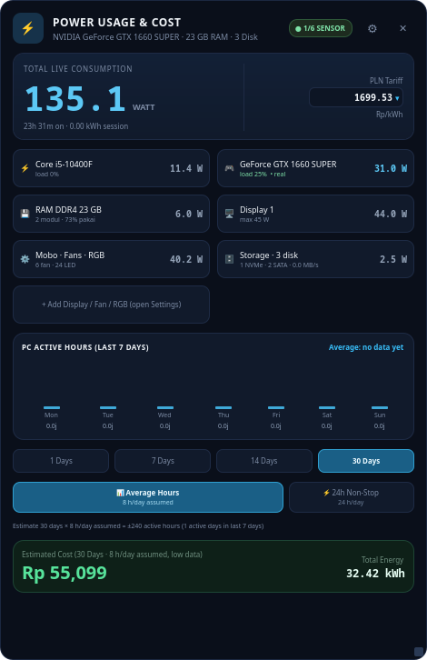
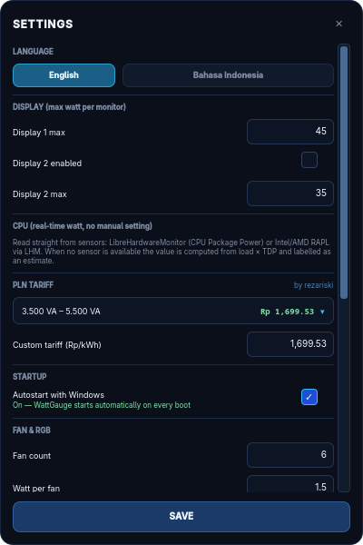
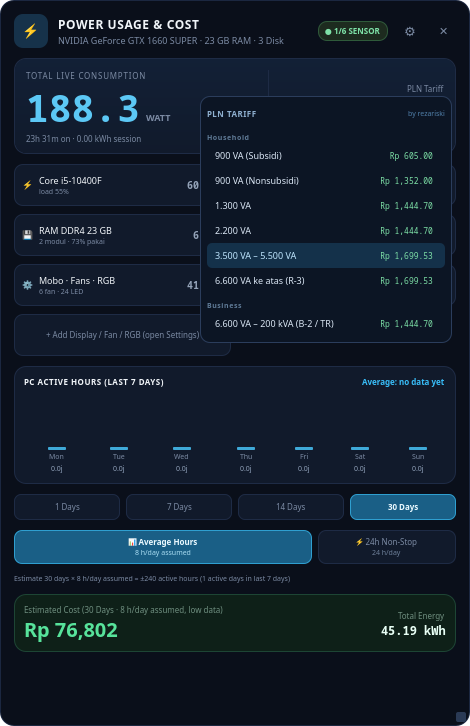

# WattGauge

Real-time PC power monitor with PLN (Indonesia) electricity-cost estimates for Windows 10/11.

**[⬇ Download WattGauge 1.2.0 (Windows 64-bit, 64 MB)](https://github.com/rezariski42/WattGauge/releases/latest)** — unzip, run `WattGauge-Setup-1.2.0.exe`. No Python required.



Built with Python + PyQt6 (QML UI) and shipped as a per-user installer: portable Python 3.12
and all PyQt6 wheels are bundled, so the target PC does not need Python installed.

## Features

- Real-time total wattage broken down per component (CPU, GPU, RAM, display, mobo/fan/RGB, storage).
- CPU watts read from sensors (LibreHardwareMonitor / RAPL via LHM). Without a sensor the value is
  computed from load × TDP and labelled *estimate*.
- GPU detected automatically via `nvidia-smi` (no GPU = no GPU tile).
- Active-hours history per weekday (Mon–Sun), stored in SQLite at `%APPDATA%\WattGauge\history.db`.
- kWh and Rp cost projection: *Average Hours* mode (uses your real active days) or *24h Non-Stop* mode.
- **PLN tariff presets** grouped by Household / Business, plus a custom Rp/kWh field:
  - 900 VA (Subsidi) — Rp 605/kWh
  - 900 VA (Nonsubsidi) — Rp 1.352/kWh
  - 1.300 VA / 2.200 VA — Rp 1.444,70/kWh
  - 3.500 VA – 5.500 VA / 6.600 VA+ (R-3) — Rp 1.699,53/kWh
  - 6.600 VA – 200 kVA (B-2 / TR, Business) — Rp 1.444,70/kWh
  - Custom tariff for anything else
- **Language switch**: English (default) and Bahasa Indonesia, changeable in Settings.
- **Closing the window keeps the app running in the background** (tray icon), so cost keeps counting.
  Quit for real from the tray menu or `Ctrl+Q`.
- Frameless mini watt widget docked bottom-right above the taskbar (watt + Rp/hour). Click it to
  show/hide the main window.
- Tray icon painted with live digits + tooltip + window title wattage.
- Resizable/scalable window (last size remembered).
- **Autostart on boot by default**, toggleable in Settings.
- Settings footer: version, credit, "Check for update" and "Open GitHub" buttons.




<sub>Bahasa Indonesia: `docs/preview-main-id.png`, `docs/preview-settings-id.png`.</sub>

## Install

1. Download `WattGauge-Setup-1.2.0.exe` (from the zip).
2. Run it — per-user install, no admin needed.
3. Wizard: Next → Install → Finish (the app opens immediately).

Installs to `%LOCALAPPDATA%\Programs\WattGauge`, creates Desktop + Start Menu shortcuts,
an *Apps & features* uninstall entry, and an autostart entry under
`HKCU\Software\Microsoft\Windows\CurrentVersion\Run`.

Disable autostart any time: open Settings (gear icon or `Ctrl+,`) → STARTUP → uncheck
"Autostart with Windows" → SAVE.

## Shortcuts

| Key | Action |
| --- | --- |
| `Ctrl+,` | Open Settings |
| `Ctrl+Q` | Quit (from tray menu too) |
| Click mini widget | Show / hide main window |
| Drag window corner | Resize / scale UI |

## Build from source

Requires Linux or Windows with NSIS 3.x. The Windows runtime comes from the NuGet `python`
package (portable CPython 3.12.8) plus PyQt6/psutil win_amd64 wheels.

```bash
cd build
# stage payload: build/stage/WattGauge/{python,app}
NSISDIR=$PWD/nsis/usr/share/nsis ./nsis/usr/bin/makensis installer/installer.nsi
```

Output: `build/WattGauge-Setup.exe`.

## Structure

```
app/
  main.py                 entry point, tray, mini widget, --selftest
  engine.py               sampler thread, snapshot, cost, autostart, i18n, update check
  config.py               JSON config in %APPDATA%\WattGauge
  history.py              SQLite daily history + averages
  telemetry/windows.py    Windows collector (LHM WMI, nvidia-smi, CIM)
  telemetry/linux.py      Linux collector (RAPL, nvidia-smi) for dev
  qml/Main.qml            dashboard
  qml/Settings.qml        settings (language, tariff, startup, about)
  qml/TopBar.qml          frameless mini watt widget
  qml/i18n.js             EN/ID strings + PLN tariff table
build/installer/installer.nsi
docs/preview-*.png
```

## Accuracy notes

In a VM without GPU passthrough, wattage is an estimate. Real sensor values (CPU package power,
GPU power draw) only appear on physical hardware with LibreHardwareMonitor (WMI) or the NVIDIA
driver.

---
by rezariski · MIT